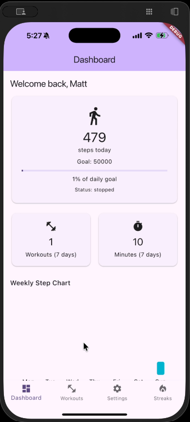
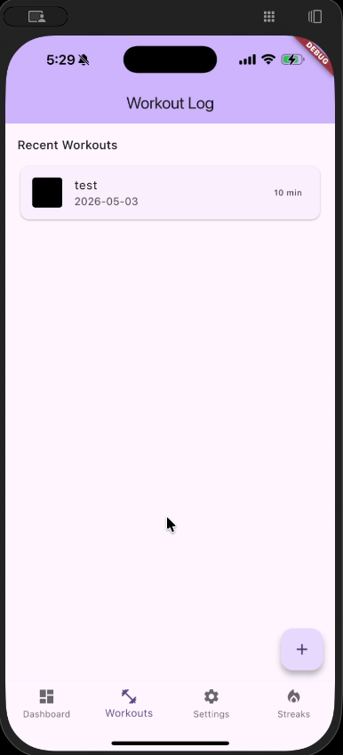
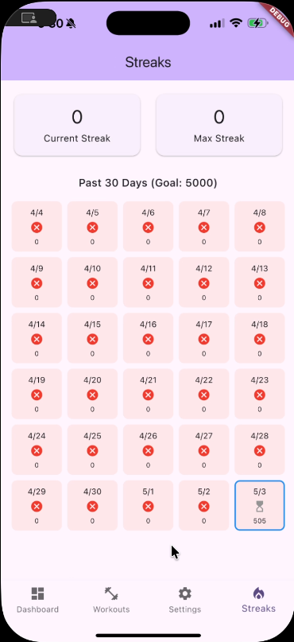
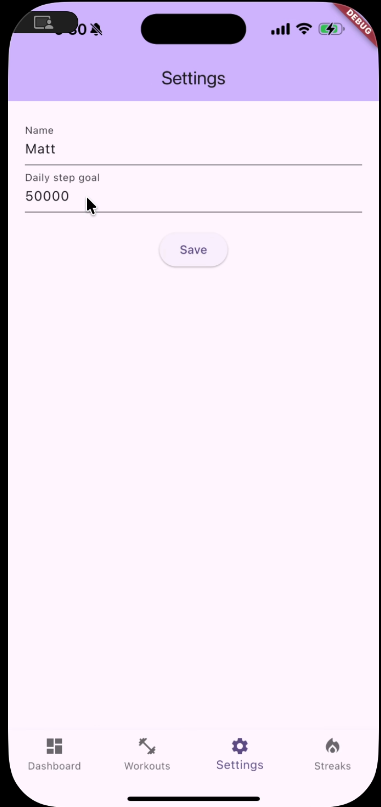

# FitTrack

A local-first Flutter fitness tracker that combines live pedometer data, workout logging, weekly analytics, configurable goals, and streak tracking in one mobile app.

FitTrack was developed as the final team project for **CMSC436: Programming Handheld Systems at the University of Maryland**. The app intentionally avoids accounts and cloud services: health and workout data stays in an on-device SQLite database.

---

## Features

- Tracks live steps and pedestrian status using the device pedometer
- Handles Android activity-recognition permissions
- Stores daily step history, workouts, and settings in SQLite
- Shows progress toward a configurable daily goal
- Visualizes seven days of step history with `fl_chart`
- Logs workouts with duration and an optional local photo
- Calculates current and best goal streaks on a 30-day activity grid
- Persists a display name and daily step goal across launches
- Debounces step writes to avoid excessive database operations

---

## Screenshots

| Dashboard | Workout Log | Streaks | Settings |
|---|---|---|---|
|  |  |  |  |

---

## Tech Stack

- Flutter and Dart
- SQLite with `sqflite`
- Device pedometer streams
- Runtime permissions with `permission_handler`
- Charts with `fl_chart`
- Local image selection with `file_picker`

---

## Architecture

```txt
lib/
├── main.dart
├── database_helper.dart
└── screens/
    ├── dashboard_screen.dart
    ├── workout_log_screen.dart
    ├── settings_screen.dart
    └── streaks_screen.dart
```

`DatabaseHelper` owns the versioned SQLite schema and data-access methods. The four screens consume that local data while the dashboard also listens to asynchronous pedometer streams.

---

## How to Run

### Prerequisites

- Flutter SDK compatible with Dart 3.11 or newer
- Android Studio or Xcode for a mobile simulator/device
- A physical device for meaningful pedometer testing

### Setup

```bash
git clone https://github.com/JacobDemory/fit-track.git
cd fit-track
flutter pub get
flutter run
```

The pedometer feature depends on device hardware and platform permission support. Other screens can still be reviewed in a simulator.

### Quality Checks

```bash
flutter analyze
flutter test
```

---

## Data Model

FitTrack stores three local tables:

- `workouts`: name, date, duration, and optional image path
- `daily_steps`: one accumulated step count per date
- `settings`: persistent key/value preferences

No health information is transmitted to a remote service.

---

## Team

FitTrack was built by **CMSC436 Team 36**:

- Matthew Pallan
- Calvin Vogan
- Priscilla Chavarria
- Araav Rotella
- Jacob Demory

The repository is presented as a team project and does not claim sole authorship.

---

## Future Improvements

- Integrate Apple Health and Health Connect
- Add cloud backup and cross-device synchronization
- Add workout categories, search, and filtering
- Add reminders, achievements, and milestone badges
- Expand analytics with monthly and yearly views
- Improve accessibility and automated device testing
